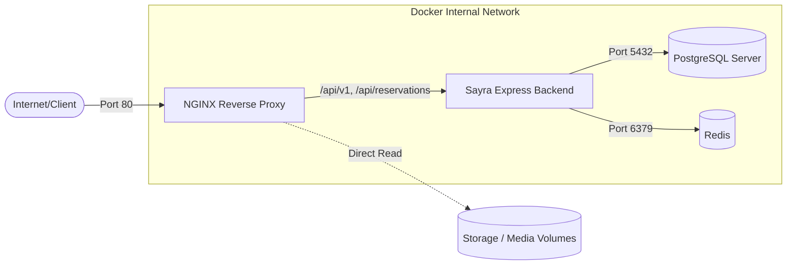

# NGINX Integration Guide

This document describes the NGINX integration into the PlayNest Docker-based infrastructure.

## Architecture Overview

The integration introduces NGINX as a production-grade reverse proxy and load balancer in front of the Sayra reservation backend.

### Network Flow Diagram

## Routing & Services Overview

- `/api/v1/` & `/api/reservations/` → `sayra` backend service (`http://sayra:3000`).
- `/health`, `/api-docs`, `/swagger`, `/redoc`, `/redoc-assets`, `/docs`, `/openapi.yaml`, `/openapi.json` → `sayra` health checks and Sayra documentation endpoints.
- `${MEDIA_LOCAL_PUBLIC_PATH}` (e.g. `/media`) → Static media storage (`/app/storage`).
- `/` → Gateway status placeholder.

## Configuration Files

- `docker/nginx/nginx.conf`: Global NGINX settings.
- `docker/nginx/conf.d/app.conf.template`: Application server blocks and routing templates.
- `docker/nginx/Dockerfile`: Custom NGINX image build instructions.
