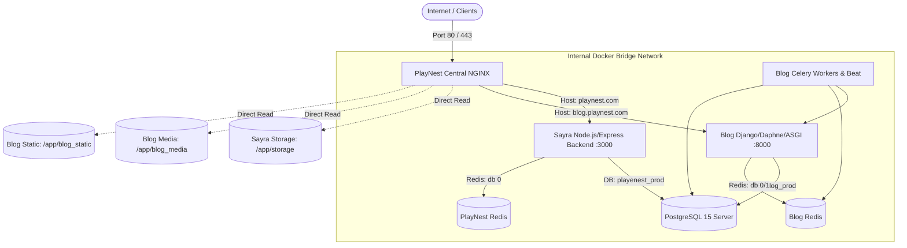

# NGINX Integration Guide

This document describes the centralized NGINX integration into the PlayNest unified Docker-based deployment architecture.

## Unified Architecture Overview

Central NGINX functions as the single public entry point (Reverse Proxy & Edge Gateway) on ports 80/443, routing traffic based on domain names:
- **PlayNest (Main Platform / Sayra Backend)**: Routes `playnest.com` (and fallback `_`) to `sayra:3000`.
- **Blog (Independent Django / Daphne / Channels Backend)**: Routes `blog.playnest.com` to `blog_web:8000`.

### Network Flow Diagram

## Routing & Services Overview

### 1. Main Platform (`playnest.com` / `www.playnest.com` / default fallback)
- `/api/v1/` & `/api/reservations/` → `sayra` backend service (`http://sayra:3000`).
- `/health`, `/api-docs`, `/swagger`, `/redoc`, `/redoc-assets`, `/docs`, `/openapi.yaml`, `/openapi.json` → `sayra` health checks and Sayra documentation endpoints.
- `${MEDIA_LOCAL_PUBLIC_PATH}` (e.g. `/media`) → Static media storage (`/app/storage`).
- `/uploads/` → User uploaded media files served via `sayra` Express backend (`http://sayra:3000/uploads/`).
- `/` → Gateway status placeholder.

### 2. Blog Platform (`blog.playnest.com`)
- `/` → Django / Daphne ASGI backend (`http://blog_web:8000`), with full HTTP/1.1 WebSocket Upgrade support for Channels.
- `/static/` → Blog collected static files (`/app/blog_static`).
- `/media/` → Blog uploaded media files (`/app/blog_media`).

## Configuration Files

- `docker/nginx/nginx.conf`: Global NGINX settings.
- `docker/nginx/conf.d/app.conf.template`: Multi-domain virtual host templates.
- `docker/nginx/Dockerfile`: Custom NGINX image build instructions.
