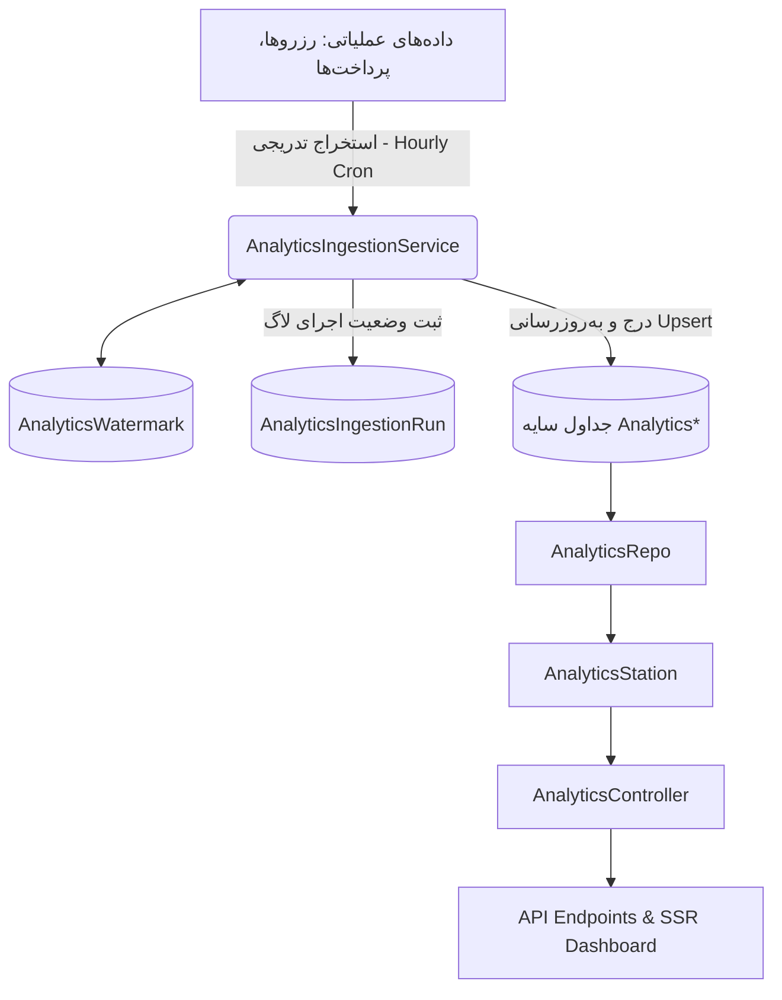

# راهنمای جامع سیستم تحلیل داده و گزارش‌گیری Play-Nest (Play-Nest Analytics System Guide)

---

## ۱. معرفی سیستم (Executive Overview)

### خلاصه مدیریتی
سیستم **Play-Nest Analytics** یک زیرسیستم هوش تجاری (BI) و گزارش‌گیری عملیاتی/مالی مستقل و غیرهمگام است که برای پلتفرم مدیریت گیم‌نت Play-Nest طراحی و پیاده‌سازی شده است. این سیستم به مدیران گیم‌نت‌ها (`MANAGER`) و مدیران کل پلتفرم (`ADMIN`) امکان می‌دهد تا بدون اعمال بار پردازشی سنگین بر پایگاه‌داده عملیاتی و اصلی پلتفرم، به گزارش‌های دقیق مالی، رفتاری مشتریان، بهره‌وری دستگاه‌ها، عملکرد کارکنان و مقایسه‌های صریح و حفظ‌کننده حریم خصوصی (Benchmarking) دسترسی داشته باشند.

### چرا Play-Nest Analytics پیاده‌سازی شد؟
در سامانه‌های عملیاتی رزرو و مدیریت گیم‌نت، کوئری‌های پیچیده تحلیلی (مانند محاسبه نرخ بازگشت مشتری، ماتریس کوهورت و مغایرت‌گیری مالی) که نیاز به اسکن و تجمیع حجم بالایی از داده‌های رزرو و پرداخت دارند، در صورت اجرا مستقیم بر روی جداول عملیاتی موجب قفل شدن جداول (Table Lock)، کندی فرایند رزرو آنلاین و افت تجربه کاربری بازیکنان می‌شوند.

برای حل این مشکل، معماری Play-Nest Analytics به صورت **معماری سایه (Shadow Read Storage)** طراحی شد. داده‌های عملیاتی به صورت تدریجی (Incremental) و توسط سرویس‌های پس‌زمینه (BullMQ Workers) به جداول اختصاصی تحلیلی منتقل شده و کوئری‌های گزارش‌گیری تماماً بر روی این جداول بهینه‌سازی‌شده اجرا می‌شوند.

### چه مشکلاتی را حل می‌کند؟
۱. **تفکیک بار عملیاتی از بار تحلیلی (OLTP vs OLAP segregation):** جلوگیری از کندی دیتابیس در زمان رزروهای هم‌زمان.
۲. **شفافیت و مغایرت‌گیری مالی:** کشف خودکار ناهماهنگی‌ها بین رزرو، پرداخت و دفترکل مالی با قوانین تشخیصی `REC-001` تا `REC-006`.
۳. **تحلیل رفتار و وفاداری مشتریان:** دسته‌بندی مشتریان به گروه‌های جدید، تکراری، VIP و در معرض ریزش (At-Risk) بدون به خطر افتادن حریم خصوصی.
۴. **ارزیابی بهره‌وری تجهیزات و کارکنان:** محاسبه دقیق نرخ بهره‌وری دستگاه‌ها (Utilization Rate) و درآمدزایی کارکنان.
۵. **مقایسه عملکرد با همتایان (Benchmarking):** مقایسه عملکرد گیم‌نت با میانگین شاخص‌های صنعت با رعایت کامل الگوریتم $k$-Anonymity ($k \ge 5$).

---

## ۲. کاربران و کاربردهای سیستم (User Roles & Access Matrix)

نقش‌های کاربری در پلتفرم Play-Nest بر اساس Enum مربوط به `UserRole` در Prisma تعریف می‌شوند:

| نقش کاربری | نحوه احراز هویت | سطح دسترسی به APIهای Analytics | دامنه دسترسی (Scope) | دسترسی به داده‌های مالی | دسترسی به بنچ‌مارک | وضعیت پیاده‌سازی و شواهد فنی |
|---|---|---|---|---|---|---|
| **`ADMIN`** | توکن Bearer JWT | دسترسی کامل به تمام ۱۹ API تحلیلی و داشبورد SSR | کل پلتفرم یا گیم‌نت انتخابی | دسترسی کامل (جمع کل، خالص، دفترکل، مغایرت‌گیری) | دسترسی کامل ($k \ge 5$) | تاییدشده (`sayra/src/common/middleware/requireRole.ts`) |
| **`MANAGER`** | توکن Bearer JWT | دسترسی کامل به ۱۹ API تحلیلی گیم‌نت تحت مالکیت | فقط گیم‌نت اختصاصی (`gamingCenterId`). تلاش برای دسترسی به سایر گیم‌نت‌ها منجر به `HTTP 404` می‌شود | دسترسی کامل به داده‌های مالی همان گیم‌نت | دسترسی به شاخص‌های مقایسه‌ای صنعت ($k \ge 5$) | تاییدشده (`sayra/src/common/middleware/tenantGuard.ts`) |
| **`STAFF`** | توکن Bearer JWT | عدم دسترسی (`HTTP 403 Forbidden`) | N/A | عدم دسترسی | عدم دسترسی | تاییدشده در تست‌های API |
| **`CUSTOMER`** | توکن Bearer JWT | عدم دسترسی (`HTTP 403 Forbidden`) | N/A | عدم دسترسی | عدم دسترسی | تاییدشده در تست‌های API |

---

## ۳. سیستم چه داده‌هایی استخراج می‌کند؟ (Data Sources & Ingestion Inventory)

سیستم استخراج داده‌های تحلیلی (Analytics Ingestion Pipeline) داده‌های عملیاتی را از جداول اصلی خوانده و در جداول سایه تحلیلی ذخیره می‌کند.

| نام دامنه داده | منبع داده اصلی | فیلدهای کلیدی استخراج‌شده | جدول مقصد تحلیلی (Shadow Model) | روش به‌روزرسانی | اطلاعات حساس و محافظت |
|---|---|---|---|---|---|
| **مستأجران / گیم‌نت‌ها** | `GamingCenter` | `id, name, slug, isActive, pcCount, consoleCount, hourlyRate` | `AnalyticsTenant` | Upsert بر اساس `updatedAt` | هیچ داده حساسی ندارد |
| **مشتریان** | `CustomerAccount` | `id, gamingCenterId, phone, fullName, walletBalance` | `AnalyticsCustomer` | Upsert تدریجی | شماره تلفن در APIها ماسک می‌شود (`0912***1234`) |
| **دستگاه‌ها / ایستگاه‌ها** | `GameStation` | `id, gamingCenterId, name, stationType, isVip, hourlyPrice` | `AnalyticsStation` | Upsert تدریجی | فاقد داده حساس |
| **رزروها** | `Reservation` | `id, gamingCenterId, customerAccountId, stationId, startTime, endTime, totalPrice, status` | `AnalyticsReservation` | Upsert تدریجی | شناسه مشتری جهت آمار خروجی گرفته می‌شود |
| **جلسات بازی** | `GamingSession` | `id, reservationId, stationId, startTime, endTime, actualHours, status` | `AnalyticsGamingSession` | Upsert تدریجی | فاقد داده حساس |
| **پرداخت‌ها** | `Payment` | `id, gamingCenterId, reservationId, amount, currency, provider, status, method, paidAt` | `AnalyticsPayment` | Upsert تدریجی | تمام مبالغ در واحد خرد ریال نگهداری می‌شوند |
| **تراکنش‌های دفترکل** | `LedgerEntry` | `id, gamingCenterId, paymentId, refundId, entryType, amount, currency` | `AnalyticsLedgerEntry` | Upsert تدریجی | فاقد داده حساس |
| **بازپرداخت‌ها / استردادها** | `Refund` | `id, gamingCenterId, paymentId, amount, status, processedAt` | `AnalyticsRefund` | Upsert تدریجی | فاقد داده حساس |

---

## ۴. شاخص‌ها و گزارش‌های قابل استخراج (Metrics Catalog)

### ۱. درآمد کل شناخته‌شده (`totalRevenue`)
- **تعریف کسب‌وکاری:** مجموع ارزش ریالی رزروهای تکمیل‌شده در بازه زمانی انتخاب‌شده.
- **فرمول محاسبه:** `SUM(AnalyticsReservation.totalPrice)` برای رزروهای با وضعیت `COMPLETED`.
- **محل محاسبه:** `AnalyticsStation.getSummary` در `sayra/src/modules/analytics/analytics.station.ts`.

### ۲. نقدینگی وصول‌شده (`realizedCash`)
- **تعریف کسب‌وکاری:** مجموع پرداختی‌های موفق ثبت‌شده در سیستم.
- **فرمول محاسبه:** `SUM(AnalyticsPayment.amount)` برای پرداخت‌های با وضعیت `PAID`.
- **محل محاسبه:** `AnalyticsRepo.getLiveFinancialStats` در `sayra/src/modules/analytics/analytics.repo.ts`.

### ۳. نرخ تکمیل رزرو (`completionRate`)
- **تعریف کسب‌وکاری:** درصد رزروهای لغونشده که با موفقیت پایان یافته‌اند.
- **فرمول محاسبه:** `ROUND((completedReservations / (totalReservations - canceledReservations)) * 100, 2)`

### ۴. نرخ بازگشت مشتری (`repeatVisitRate`)
- **تعریف کسب‌وکاری:** درصد مشتریان فعال در بازه که بیش از ۱ بار مراجعه داشته‌اند.
- **فرمول محاسبه:** `ROUND((repeatCustomersCount / activeCustomersCount) * 100, 2)`

### ۵. قوانین تشخیصی مغایرت مالی (`REC-001` تا `REC-006`)
- `REC-001`: تطابق مبلغ پرداخت و تراکنش دفترکل.
- `REC-002`: بررسی پرداخت رزروهای تکمیل‌شده.
- `REC-003`: تطابق تراکنش‌های بازپرداخت و دفترکل.
- `REC-004`: انطباق افزایش موجودی کیف‌پول و دفترکل.
- `REC-005`: صحت محاسبه پورسانت کارکنان.
- `REC-006`: بررسی پرداخت‌های بلاتکلیف.
- **محل محاسبه:** `AnalyticsRepo.runFinancialReconciliationCheck`.

### ۶. بنچ‌مارک‌های حفظ‌کننده حریم خصوصی ($k \ge 5$)
- محاسبه میانه (Median)، میانگین (Mean) و چارک‌ها (P25, P75) در میان حداقل ۵ گیم‌نت همتا، همراه با استثنا کردن داده‌های خود گیم‌نت متقاضی.

---

## ۵. نمونه‌های واقعی و کاربردی (Worked Numerical Examples)

> **توجه:** تمامی اعداد زیر صرفاً جنبه آموزشی و نمونه دارند و داده واقعی مشتریان نمی‌باشند.

### نمونه ۱: گزارش درآمد روزانه یک گیم‌نت
- **داده‌های ورودی:** ۵ رزرو تکمیل‌شده به مبالغ ۵۰,۰۰۰، ۱۰۰,۰۰۰، ۱۵0,۰۰۰، ۲۰۰,۰۰۰ و ۱۰۰,۰۰۰ ریال. ۱ رزرو لغوشده به مبلغ ۸۰,۰۰۰ ریال.
- **محاسبه:**
  - `totalRevenue` = ۵۰,۰۰۰ + ۱۰۰,۰۰۰ + ۱۵۰,۰۰۰ + ۲۰۰,۰۰۰ + ۱۰۰,۰۰۰ = ۶۰۰,۰۰۰ ریال.
  - `completedReservations` = ۵.
  - `canceledReservations` = ۱.
  - `completionRate` = (۵ / (۶ - ۱)) × ۱۰۰ = ۱۰۰٪.
  - `averageReservationValue` = ۶۰۰,۰۰۰ / ۵ = ۱۲۰,۰۰۰ ریال.

### نمونه ۲: تحلیل وفاداری و بازگشت مشتریان
- **داده‌های ورودی:** ۱۰ مشتری در بازه ماهانه رزرو داشته‌اند. ۴ مشتری ۱ رزرو، ۳ مشتری ۲ رزرو، و ۳ مشتری ۴ رزرو انجام داده‌اند.
- **محاسبه:**
  - `activeCustomers` = ۱۰.
  - `repeatCustomers` = ۳ + ۳ = ۶ مشتری.
  - `repeatVisitRate` = (۶ / ۱۰) × ۱۰۰ = ۶۰٪.

### نمونه ۳: بهره‌وری دستگاه‌ها (Utilization Rate)
- **داده‌های ورودی:** یک ایستگاه PS5 در بازه ۷ روزه (۱۶۸ ساعت حداکثر زمان ممکن)، مجموعاً ۴۲ ساعت رزرو شده است.
- **محاسبه:**
  - `utilizationRate` = (۴۲ / ۱۶۸) × ۱۰۰ = ۲۵٪.

### نمونه ۴: مغایرت مالی (Financial Reconciliation - REC-001)
- **داده‌های ورودی:** پرداخت آنلاین به مبلغ ۵۰۰,۰۰۰ ریال ثبت شده اما تراکنش دفترکل معادل ۴۵۰,۰۰۰ ریال درج شده است.
- **خروجی مغایرت‌گیر:**
  - Rule ID: `REC-001`.
  - Severity: `HIGH`.
  - Expected: ۵۰۰,۰۰۰ / Actual: ۴۵۰,۰۰۰.
  - Status: `DISCREPANCY`.

### نمونه ۵: بنچ‌مارک صنعت (Benchmarking - k >= 5)
- **داده‌های ورودی:** گیم‌نت A دارای نرخ تکمیل ۸۵٪ است. ۶ گیم‌نت همتا دارای نرخ‌های ۷۰٪، ۷۵٪، ۸۰٪، ۸۲٪، ۸۸٪ و ۹۰٪ هستند.
- **محاسبه:**
  - تعداد همتایان $k = 6 \ge 5$ (منتشر می‌شود).
  - میانه همتایان (Peer Median) = (۸۰ + ۸۲) / ۲ = ۸۱٪.
  - اختلاف از میانه (diffFromMedian) = ۸۵ - ۸۱ = +۴٪.

---

## ۶. معماری و نحوه کار سیستم (Architecture & Data Flow)

### ویژگی‌های کلیدی فرایند استخراج:
- **پنجره زمانی بازگشتی (Sliding Lookback Window):** بازه ۱۲۰ دقیقه‌ای برای جذب تغییرات تاخیری.
- **صفحه‌بندی بر اساس مکان‌نما (Cursor Pagination):** استفاده از `cursor: { id }` و `take: 500` جهت جلوگیری از فشار بر حافظه RAM.
- **همزادنويسی غیرتکراری (Idempotency):** استفاده از دستور `upsert` شناسه اصلی.

---

## ۷. APIها و صفحات کاربری (API Inventory & UI)

### مسیرهای اصلی API (پایه: `/api/v1/gamingCenters/:gamingCenterId/analytics`)
۱. `GET /summary` — خلاصه شاخص‌های کلیدی درآمد و رزرو.
۲. `GET /reservations` — گزارش تفکیکی رزروها و روندهای روزانه.
۳. `GET /financials` — گزارش صورت‌های مالی و روش‌های پرداخت.
۴. `GET /financials/overview` — تفکیک دقیق مالی، کیف‌پول و پورسانت‌ها.
۵. `GET /financials/reconciliation` — خروجی قوانین مغایرت‌گیری مالی.
۶. `POST /financials/reconciliation/run` — اجرای دستی فرایند مغایرت‌گیری.
۷. `GET /customers/summary` — خلاصه آمار مشتریان فعال، جدید و تکراری.
۸. `GET /customers/activity` — روندهای روزانه حضور مشتریان و هیستوگرام فواصل مراجعه.
۹. `GET /customers/retention` — ماتریس تحلیل کوهورت و نرخ ماندگاری.
۱۰. `GET /customers/segmentation` — دسته‌بندی مشتریان به NEW, REPEAT, VIP, AT_RISK.
۱۱. `GET /customers/top-spenders` — لیست برترین مشتریان پرداختی با شماره تلفن ماسک‌شده.
۱۲. `GET /stations` — نرخ بهره‌وری و کارکرد دستگاه‌ها.
۱۳. `GET /staff` — عملکرد و رتبه‌بندی کارکنان.
۱۴. `GET /operations/waitlist` — آمار نرخ تبدیل لیست انتظار.
۱۵. `GET /operations/notifications` — نرخ خطای ارسال پیامک‌ها.
۱۶. `GET /revenue-chart` — داده‌های نمودار زمانی درآمد روزانه.
۱۷. `GET /ingestion-status` — وضعیت تازگی داده‌ها (Freshness) و واترمارک‌ها.
۱۸. `GET /benchmarks` — شاخص‌های مقایسه‌ای صنعت با حفظ حریم خصوصی.
۱۹. `GET /growth-insights` — تحلیل توصیفی رشد و مقایسه با دوره قبل.

### صفحات UI داشبورد مدیریتی (SSR HTML)
- **مسیرها:** `/gamingCenters/:gamingCenterId/dashboard` و `/admin/gamingCenters/:gamingCenterId/dashboard`.
- **فایل منبع:** `sayra/src/modules/analytics/dashboard-ui.templates.ts`.

---

## ۸. امنیت، حریم خصوصی و جداسازی مستأجران (Security & Isolation)

۱. **احراز هویت و نقش‌ها:** الزام توکن JWT و بررسی نقش‌های `MANAGER` یا `ADMIN`.
۲. **جداسازی مستأجران (Tenant Isolation):** اعمال فیلتر اجباری `gamingCenterId` در تمامی کوئری‌های Prisma.
۳. **دفاع در برابر پیمایش شناسه‌ها (Enumeration Defense):** در صورت تلاش مدیر یک گیم‌نت برای دسترسی به شناسه گیم‌نت دیگر، میدل‌ور `tenantGuard` پاسخ **`HTTP 404 Not Found`** صادر می‌کند تا وجود شناسه لوانرود.
۴. **ماسک‌سازی شماره تلفن:** ماسک کردن ارقام میانی تلفن مشتریان (`0912***1234`) در تابع `maskPhone`.
۵. **حفظ حریم خصوصی در بنچ‌مارک ($k \ge 5$):** سرکوب خودکار نتایج در صورت کوچک بودن کوهورت همتا و استثنا کردن داده خود متقاضی.
۶. **کلید قطع اضطراری (Kill Switch):** تنظیم `ENABLE_ANALYTICS_BENCHMARKING=false` جهت غیرفعال‌سازی آنی بنچ‌مارک.

---

## ۹. محدودیت‌ها و مواردی که Analytics نمی‌تواند تضمین کند (Limitations)

۱. **تاخیر همگام‌سازی (Pipeline Lag):** به دلیل اجرای ساعتی ورکرها، داده‌های تحلیلی ممکن است تا ۱ ساعت تاخیر داشته باشند.
۲. **وابستگی به سرویس‌های جانبی:** کارکرد صحیح خط لوله مستلزم فعال بودن Redis و BullMQ Workers است.
۳. **پیش‌بینی آینده (No Predictive AI):** شاخص‌های فعلی کاملاً توصیفی (Descriptive) و بر اساس داده‌های تاریخی بوده و پیش‌بینی آینده یا LTV برآوردی ارائه نمی‌دهند.

---

## ۱۰. راهنمای استفاده مدیریتی (Managerial Usage Guide)

- **برای کاهش ظرفیت بلااستفاده:** جدول `Station Performance` را بررسی کنید. دستگاه‌های با Utilization زیر ۱۵٪ را در ساعات خلوت با تخفیف پیشنهاد دهید.
- **برای افزایش بازگشت مشتری:** به بخش `Customer Segmentation` مراجعه کنید. مشتریان گروه `AT_RISK` (دارای ۳ مراجعه در گذشته که در ۶۰ روز اخیر مراجعه نداشته‌اند) را شناسایی کرده و کد تخفیف ارسال کنید.
- **برای کنترل حساب‌های مالی:** بر روی دکمه `Run Audit Check` در بخش Reconciliation کلیک کنید تا ناهماهنگی‌های بین کیف‌پول، پرداخت و دفترکل بررسی شوند.

---

## ۱۱. عملیات و نگهداری فنی (Technical Operations)

### دستورات کلیدی اجرا و راست‌آزمایی
- **اجرای تست‌های واحد و یکپارچگی:** `cd sayra && npm test`
- **اعتبارسنجی سند OpenAPI:** `cd sayra && npm run api:validate`
- **بررسی تایپ‌های تایپ‌اسکریپت:** `cd sayra && npx tsc --noEmit --ignoreDeprecations 5.0`
- **بررسی استانداردهای کد:** `cd sayra && npm run lint`
- **اجرای بک‌فیل تاریخچه:** `cd sayra && npm run backfill:analytics`

---

## ۱۲. جمع‌بندی وضعیت سیستم و پیوست شواهد (System Status Summary)

| بخش تحلیلی | وضعیت پیاده‌سازی | شواهد و فایل‌های منبع اصلی |
|---|---|---|
| زیرساخت استخراج داده (Phase 1) | `VERIFIED` | `sayra/src/modules/analytics/analyticsIngestionService.ts` |
| داشبورد مدیریتی SSR (Phase 2) | `VERIFIED` | `sayra/src/modules/analytics/dashboard-ui.templates.ts` |
| تحلیل مشتریان و کوهورت (Phase 3) | `VERIFIED` | `sayra/tests/unit/modules/analytics/analytics.customers.spec.ts` |
| گزارش‌های مالی و مغایرت‌گیری (Phase 4) | `VERIFIED` | `sayra/tests/unit/modules/analytics/analytics.financials.spec.ts` |
| سخت‌سازی و ورکرهای پس‌زمینه (Phase 5) | `VERIFIED` | `sayra/src/jobs/workers/analyticsIngestion.worker.ts` |
| تفکیک مستأجران و حریم خصوصی (Phase 6) | `VERIFIED` | `sayra/tests/unit/modules/analytics/analytics.phase6.spec.ts` |
| بنچ‌مارک و تحلیل رشد (Phase 7) | `VERIFIED` | `sayra/tests/unit/modules/analytics/analytics.benchmarks.spec.ts` |

---

### پیوست شواهد کدهای منبع (Source Code Evidence Appendix)
- **مسیرهای API:** `sayra/src/modules/analytics/analytics.routes.ts`
- **کنترلر تحلیلی:** `sayra/src/modules/analytics/analytics.controller.ts`
- **سرویس ایستگاه تحلیلی:** `sayra/src/modules/analytics/analytics.station.ts`
- **ریپازیتوری تحلیلی:** `sayra/src/modules/analytics/analytics.repo.ts`
- **مایگریشن دیتابیس:** `sayra/prisma/migrations/20261210000000_add_analytics_infrastructure/migration.sql`
- **سند اسواگر:** `sayra/src/docs/openapi.yaml`
