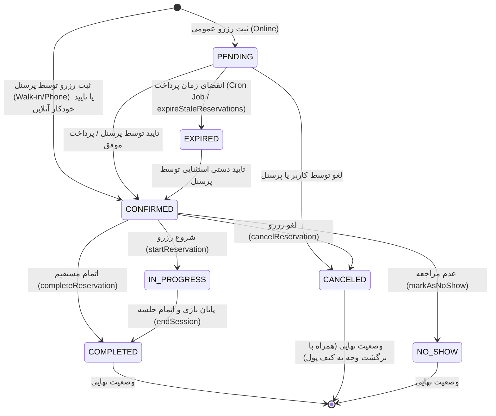

# چرخه حیات و جریان‌های اجرایی رزرو (Reservation Lifecycle & Execution Flows)

## ۱. خلاصه‌ی معماری جریان‌ها (Flow Architecture Overview)

سیستم رزرو پلتفرم PlayNest / Sayra شامل جریان‌های مستقیم همگام (Synchronous API Requests)، عملیات داخل تراکنش‌های پایگاه داده (Prisma Transactions)، رویدادهای درون‌برنامه‌ای (EventEmitter)، و پردازش‌های پس‌زمینه (BullMQ Workers & Schedulers) می‌باشد.

این مستند تمام نقاط ورودی (Entry Points)، چرخه‌ی تغییر وضعیت رزرو (State Machine)، سلسله مراتب فراخوانی توابع، و رویدادهای جانبی را بر اساس کد واقعی پروژه تحلیل می‌کند.

---

## ۲. دیاگرام وضعیت رزرو (State Machine Diagram)

بر اساس کلاس `ReservationStateMachine` در فایل `sayra/src/modules/reservation/reservation.state-machine.ts` و فایل‌های مربوطه:

---

## ۳. تحلیل جریان‌های اصلی رزرو (Detailed Reservation Flows)

### جریان ۱: ثبت رزرو عمومی (Public Online Reservation)
* **نقطه ورودی API:** `POST /api/v1/public/reservations`
* **مسیر فایل روت:** `sayra/src/modules/reservation/reservation.public.routes.ts`
* **میدل‌ورها:** `publicReservationRateLimiter` -> `resolveGamingCenterBySlug` -> `validate(createPublicReservationSchema)` -> `idempotencyMiddleware` -> `asyncHandler(createPublicReservation)`
* **سلسله مراتب فراخوانی توابع:**
  1. `reservationController.createPublicReservation` (`sayra/src/modules/reservation/reservation.controller.ts`)
  2. `reservationStation.createPublicReservation` (`sayra/src/modules/reservation/reservation.station.ts`)
  3. `ReservationRepo.transaction` با سطح ایزوله‌سازی `RepeatableRead` (`sayra/src/modules/reservation/reservation.repo.ts`)
* **ترتیب اعتبارسنجی‌ها و قوانین:**
  * بررسی فعال بودن `allowOnlineBooking` در تنظیمات مرکز بازی (`Settings`).
  * بررسی زمان شروع رزرو (`startTime` نباید در گذشته باشد).
  * بررسی احراز هویت پیامکی (`requireOtpForPublicBooking`): اگر فعال باشد، آخرین کد OTP تأییدشده شماره تلفن مشتری در ۵ دقیقه اخیر چک می‌شود (`AuthRepository.findRecentConsumedOtp`).
  * قفل بدبینانه ایستگاه بازی: `ReservationRepo.lockStationForUpdate(stationId, tx)` با اجرای `SELECT id FROM "GameStation" WHERE id = $1 FOR UPDATE`.
  * استعلام ایستگاه و پرسنل (بررسی فعال بودن و انتساب مهارت).
  * اعتبارسنجی شیفت کاری پرسنل (`findStaffShift`) بر اساس روز هفته و منطقه زمانی مرکز (`timeZone`).
  * اعتبارسنجی همپوشانی تداخل رزرو (`findOverlappingReservation`).
  * یافتن یا ایجاد حساب و پروفایل مشتری (`findOrCreateCustomerProfile`).
  * اعتبارسنجی سقف رزروهای فعال: `assertActiveReservationLimitNotExceeded` (حداکثر ۲ رزرو فعال یا در انتظار).
  * محاسبه تخفیف‌های فعال (`discountsStation.calculateApplicableDiscount`).
  * تعیین وضعیت اولیه: اگر `onlineBookingAutoConfirm` فعال باشد `CONFIRMED` وگرنه `PENDING` با مهلت انقضای ۱ دقیقه‌ای (`expiresAt = now + 60s`).
* **عملیات پایگاه داده:**
  * `INSERT INTO "CustomerAccount" / "CustomerProfile"`
  * `INSERT INTO "Reservation"`
* **رویدادها و عوارض جانبی (Side Effects):**
  * صدور رویداد asynchronous: `eventEmitter.emit(AppEvents.RESERVATION_CREATED)`
  * ثبت متریک Prometheus: `Metrics.recordReservationCreated`

---

### جریان ۲: ثبت رزرو مستقیم توسط پرسنل (Staff / Admin Reservation)
* **نقطه ورودی API:** `POST /api/v1/reservations`
* **مسیر فایل روت:** `sayra/src/modules/reservation/reservation.routes.ts`
* **میدل‌ورها:** `authMiddleware` -> `tenantGuard` -> `requireRole([UserRole.MANAGER, UserRole.SUPERVISOR])` -> `validate(createReservationSchema)`
* **سلسله مراتب فراخوانی:**
  1. `reservationController.createReservation`
  2. `reservationStation.createReservation`
  3. `ReservationRepo.transaction` (`RepeatableRead`)
* **تفاوت با رزرو عمومی:**
  * نیازی به بررسی شیفت پرسنل یا انقضای ۱ دقیقه‌ای ندارد.
  * وضعیت رزرو به صورت مستقیم روی `CONFIRMED` قرار می‌گیرد.
  * قفل ایستگاه (`lockStationForUpdate`) و کنترل تداخل تداخل رزرو (`findOverlappingReservation`) اجرا می‌گردد.
  * کنترل سقف ۲ رزرو فعال (`assertActiveReservationLimitNotExceeded`) اعمال می‌شود.

---

### جریان ۳: ثبت رزرو گروهی (Group Booking)
* **نقطه ورودی API:** `POST /api/v1/group-bookings` و `POST /api/v1/public/group-bookings`
* **مسیر فایل روت:** `sayra/src/modules/group-booking/group-booking.routes.ts`
* **سلسله مراتب فراخوانی:**
  1. `groupBookingController.createGroupBooking` / `createPublicGroupBooking`
  2. `GroupBookingStation.createGroupBooking` / `createPublicGroupBooking` (`sayra/src/modules/group-booking/group-booking.station.ts`)
  3. `GroupBookingRepo.transaction` (`RepeatableRead`)
* **منطق اجرا:**
  * مرتب‌سازی و قفل‌گذاری همزمان چند ایستگاه به ترتیب ID برای جلوگیری از Deadlock (`ReservationRepo.lockStationsForUpdate(stationIds, tx)`).
  * اعتبارسنجی عدم تکرار ایستگاه در درخواست.
  * اعتبارسنجی حداقل و حداکثر ساعات اجاره هر ایستگاه (`minRentHours`, `maxRentHours`).
  * بررسی تداخل همزمان کلیه ایستگاه‌ها (`findOverlappingReservationsForStations`).
  * محاسبه قیمت و تخفیف تک‌تک آیتم‌ها و ایجاد سوابق `GroupBooking` و `GroupBookingItem` و `Reservation`.

---

### جریان ۴: ویرایش و تغییر زمان رزرو (Update / Reschedule Reservation)
* **نقطه ورودی API:** `PATCH /api/v1/reservations/:reservationId`
* **سلسله مراتب فراخوانی:** `reservationController.updateReservation` -> `reservationStation.updateReservation`
* **قوانین و اعتبارسنجی‌ها:**
  * رزروهای در وضعیت‌های ترمینال (`COMPLETED`, `CANCELED`, `NO_SHOW`, `EXPIRED`) قابل ویرایش نیستند (`ReservationStateMachine.isTerminalState`).
  * در صورت تغییر زمان یا پرسنل/ایستگاه، مجدداً شیفت کاری و تداخل همپوشانی چک می‌شود.
  * بازتخفیف‌گیری و محاسبه مجدد قیمت نهایی در صورت تغییر زمان یا ایستگاه.
  * ثبت لاگ نوبت‌دهی و تغییرات در `AuditLog`.

---

### جریان ۵: لغو رزرو و بازگشت وجه (Cancel & Wallet Refund)
* **نقطه ورودی API:** `POST /api/v1/reservations/:reservationId/cancel`
* **سلسله مراتب فراخوانی:**
  1. `reservationController.cancelReservation`
  2. `reservationStation.cancelReservation`
  3. `ReservationStateMachine.validateTransition(current, CANCELED)`
  4. `walletService.refundReservationToWallet(reservationId, tx)`
* **عملیات مالی همگام داخل تراکنش:**
  * استعلام تمام پرداخت‌های موفق (`PaymentStatus.PAID`) مرتبط با رزرو.
  * محاسبه مجموع مبلغ پرداختی منهای بازپرداخت‌های قبلی (`WalletTransactionType.REFUND`).
  * افزایش موجودی کیف پول مشتری (`CustomerAccount.walletBalance += refundAmount`).
  * ثبت تراکنش کیف پول با نوع `REFUND`.
  * تغییر وضعیت رزرو به `CANCELED`.
  * انتشار رویداد `AppEvents.RESERVATION_CANCELED`.

---

### جریان ۶: پیشنهاد زمان جدید توسط پرسنل (Time Proposal Flow)
* **نقطه ورودی API:**
  * پیشنهاد توسط پرسنل: `POST /api/v1/reservations/:reservationId/propose-time`
  * پاسخ مشتری: `POST /api/v1/customer-panel/proposals/:proposalId/respond` (`sayra/src/modules/customer-panel/customer-panel.station.ts`)
* **منطق پیشنهاد:**
  * پرسنل زمان پیشنهادی جدید را ثبت می‌کنند (`ReservationTimeProposal` با وضعیت `PENDING`).
  * هر پیشنهاد قبلی در حالت `PENDING` لغو (`CANCELLED`) می‌شود.
* **منطق پاسخ مشتری:**
  * در صورت پذیرش (`ACCEPTED`): وضعیت رزرو به `CONFIRMED` تغییر یافته و زمان رزرو به زمان پیشنهادی به‌روزرسانی می‌شود.
  * در صورت رد (`REJECTED`): پیشنهاد رد شده و زمان رزرو تغییر نمی‌کند.

---

### جریان ۷: پرداخت آنلاین و وب‌هوک (Payment Gateway & Webhook Lifecycle)
* **نقطه ورودی ایجاد پرداخت:** `POST /api/v1/payments/checkout` (`sayra/src/modules/payments/payments.routes.ts`)
* **نقطه ورودی وب‌هوک:** `POST /api/v1/webhooks/payment/:provider` (`sayra/src/modules/webhooks/webhooks.routes.ts`)
* **احراز هویت وب‌هوک:** میدل‌ور `verifyPaymentWebhookSignature` امضای درگاه را اعتبارسنجی می‌کند.
* **پردازش وب‌هوک (`webhooksStation.handlePaymentWebhook`):**
  * بررسی Idempotency بر اساس `providerPaymentId` در جدول `Payment`.
  * در صورت تایید پرداخت (`PAID`):
    * تغییر وضعیت رکورد `Payment` به `PAID` و ثبت `paidAt`.
    * تغییر وضعیت `paymentState` رزرو به `PAID`.
    * اگر رزرو در وضعیت `PENDING` باشد، وضعیت آن به `CONFIRMED` ارتقا می‌یابد.
    * صدور رویداد `AppEvents.PAYMENT_SUCCESS`.

---

### جریان ۸: پردازش‌های پس‌زمینه و انقضای خودکار (Background Jobs & Expiration)
* **جاب انقضای رزروهای معطل:** متد `reservationStation.expireStaleReservations` به صورت دوره‌ای رزروهای در حالت `PENDING` که زمان `expiresAt` آن‌ها از زمان جاری گذشته است را به `EXPIRED` تغییر می‌دهد.
* **جاب محاسبه کمیسیون (Commission Calculation Worker):** پس از اتمام رزرو (`COMPLETED`)، ورث‌کر `commissionCalcWorker` به صورت نامتقارن سهم سامانه را بر اساس `CommissionPolicy` محاسبه و در جدول `Earning` ثبت می‌نماید.
* **جاب ارسال پیامک (SMS Worker):** در پاسخ به رویدادهای رزرو، پیامک‌های اطلاع‌رسانی از طریق صف BullMQ و پنل SMS.ir ارسال می‌گردند.

---

## ۴. خلاصه زنجیره فراخوانی توابع (Function Call Chains Summary)

| جریان (Flow) | Entry Endpoint | Controller Function | Station Service | Repo & Transaction | DB State Changes |
| :--- | :--- | :--- | :--- | :--- | :--- |
| **Public Reservation** | `POST /public/reservations` | `createPublicReservation` | `reservationStation.createPublicReservation` | `ReservationRepo.transaction` (`RepeatableRead`) | `CustomerProfile`, `Reservation` (`PENDING`/`CONFIRMED`) |
| **Staff Reservation** | `POST /reservations` | `createReservation` | `reservationStation.createReservation` | `ReservationRepo.transaction` (`RepeatableRead`) | `Reservation` (`CONFIRMED`) |
| **Group Booking** | `POST /group-bookings` | `createGroupBooking` | `GroupBookingStation.createGroupBooking` | `GroupBookingRepo.transaction` (`RepeatableRead`) | `GroupBooking`, `GroupBookingItem`, `Reservation` |
| **Confirm** | `POST /reservations/:id/confirm` | `confirmReservation` | `reservationStation.confirmReservation` | `ReservationRepo.updateReservationWithInclude` | `Reservation.status = CONFIRMED` |
| **Cancel** | `POST /reservations/:id/cancel` | `cancelReservation` | `reservationStation.cancelReservation` | `walletService.refundReservationToWallet` | `Reservation.status = CANCELED`, `CustomerAccount.walletBalance`, `WalletTransaction` |
| **Start Session** | `POST /reservations/:id/start` | `startReservation` | `reservationStation.startReservation` | `gamingSessionsStation.startSession` | `Reservation.status = IN_PROGRESS`, `GamingSession` (`ACTIVE`) |
| **Complete** | `POST /reservations/:id/complete` | `completeReservation` | `reservationStation.completeReservation` | `gamingSessionsStation.endSession`, `commissionsStation` | `Reservation.status = COMPLETED`, `GamingSession`, `Earning` |
| **Payment Webhook** | `POST /webhooks/payment/:provider` | `handlePaymentWebhook` | `webhooksStation.handlePaymentWebhook` | `paymentsRepo.updatePaymentStatus` | `Payment.status = PAID`, `Reservation.paymentState = PAID`, `Reservation.status = CONFIRMED` |
